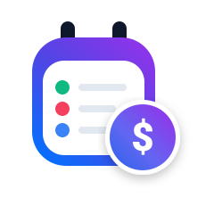

<div align="center">
  
  <h1>SubTrack</h1>
  <p><strong>Centralized Subscription & Expense Intelligence Platform</strong></p>
  <p>Track recurring expenses, visualize financial analytics, prevent surprise renewals, and stay in total control of your digital services.</p>

  [](https://react.dev/)
  [](https://vitejs.dev/)
  [](LICENSE)
  [](https://github.com/Kishore-kumar14/subTrack.git)
</div>

---

## 📖 Overview

**SubTrack** is a modern, responsive web application engineered to solve "subscription fatigue" and eliminate surprise recurring charges. Modern households and professionals juggle dozens of digital subscriptions—from streaming and music to productivity tools, AI services, cloud storage, fitness memberships, and telecom recharges. 

SubTrack consolidates all recurring commitments into a single, intuitive interface with real-time financial pacing, urgent renewal notices, interactive calendar forecasts, and comprehensive printable reports.

---

## ✨ Key Features & Architectural Enhancements

### 1. 💳 Taskbar-Centric Subscription Management
- **Universal Taskbar CTA**: The **"+ Add Subscription"** action is stationed prominently in the primary desktop taskbar and mobile navigation bar, keeping data entry accessible from any screen.
- **Decluttered Page Interfaces**: Removed redundant in-page add buttons from the Dashboard and Subscriptions views to ensure a distraction-free analytics and auditing experience.

### 2. 🎨 Authentic Brand Vector Engine (`SubscriptionIcon.jsx`)
- **Genuine Vector SVGs**: Handcrafted, scalable SVGs for **22+ top platforms**:
  - *Streaming & Media*: Netflix, Spotify, YouTube Premium, Amazon Prime, Disney+ Hotstar, JioCinema, Airtel Xstream, SonyLIV.
  - *AI & Development*: OpenAI ChatGPT, Anthropic Claude AI, GitHub Copilot.
  - *Productivity & Cloud*: Google One, Apple One / Music, Microsoft 365, Canva, Notion, Adobe Creative Cloud, Dropbox, LinkedIn Premium.
  - *Lifestyle & Fitness*: Cult.fit, Audible, Swiggy, Zomato, PlayStation Plus, Xbox Game Pass.
- **Smart Fallback Chain**: Subscriptions outside the built-in catalogue seamlessly query high-resolution domain favicons via Google Favicon API, backed by brand-colored monogram tokens.
- **Consistent Visual Hierarchy**: All service icons are rendered with standardized 10px rounded corners, crisp aspect ratios, and soft elevation shadows.

### 3. 🎯 Real-World Metaphor Iconography
Every tool, view, and metric uses intuitive physical real-world metaphors:
- **Subscriptions**: `CreditCard` (physical plastic payment card)
- **Total Monthly Outflow**: `Wallet` (physical pocket cash wallet)
- **Schedule**: `Calendar` (desk/wall flip calendar)
- **Financial Analytics**: `PieChart` / `BarChart` (printed financial ledger & charts)
- **Dashboard**: `LayoutDashboard` (physical instrument control panel)
- **Renewal Due Dates**: `Clock` (physical timepiece)
- **Urgent Alerts**: `Bell` (service brass bell)
- **Search & Filters**: `Search` (magnifying glass) & `Filter` (funnel)
- **Appearance**: `Sun` / `Moon` (celestial lighting)

### 4. 🔵 Unified Brand Theme Matching SVG Logo
- **Scalable Vector Logo (`public/logo.svg`)**: Clean SVG artwork featuring a rounded calendar clipboard with binder rings, status dot indicators, and an overlapping royal blue circular badge with the Indian Rupee symbol (`₹`).
- **Single Signature Blue**: Application palette harmonized to the logo’s royal blue:
  - **Primary**: `#2563EB` | **Light**: `#60A5FA` | **Dark**: `#1D4ED8`
  - **Gradients**: Smooth single-hue blue linear gradient (`linear-gradient(135deg, #3B82F6 0%, #2563EB 50%, #1D4ED8 100%)`).
  - Cohesive active navigation pills, buttons, glow halos, badges, and focus rings.

### 5. 💰 Currency Intelligence (INR ₹ Default & USD $ Option)
- **Default Currency**: Set to Indian Rupees (`₹` INR) across user registration, seed profiles, and system defaults.
- **Secondary Currency**: Full support for US Dollars (`$` USD) toggleable from the navigation bar or profile settings with automatic live recalculations across all views.
- **Simplified Structure**: Pruned outdated Euro, British Pound, and Japanese Yen settings for maximum consistency.

### 6. 🔒 Enterprise-Grade Password Validation
Registration includes interactive client-side password security checking against four standard criteria:
- Minimum 8 characters
- At least 1 number (`0–9`)
- At least 1 special symbol (`!@#$%^&*...`)
- At least 1 uppercase letter (`A–Z`)
- **Real-Time Feedback**: Live checklist ticks, dynamic color-coded strength bar (Red $\rightarrow$ Amber $\rightarrow$ Green), show/hide visibility toggle, and form validation gate.

### 7. 📊 Spending Analytics & Printable Financial Report
- **Category Outflow Doughnut Chart**: Interactive Recharts breakdown displaying cost per sector and percentage distribution.
- **30-Day Cash Outflow Forecast**: Chronological timeline highlighting bills due within $\le 7$ days in bold warning badges.
- **Printable Financial Report (`#subtrack-print-report`)**:
  - Executive financial summary (Active Services, Monthly Outflow, Projected Annual Outflow).
  - **Active Subscriptions Table**: Number, Name / Plan, Category, Start Date, Renewal Date, Price, Payment Method.
  - **Category-Wise Spending Table**: Breakdown of active counts, monthly burn, annual projection, and percentage of budget.
  - Dedicated `@media print` rules for paper and PDF export, automatically suppressing headers, taskbars, and web navigation.

### 8. ☀️ Day & Night Visual Contrast
- Refined typography tokens in light mode (`--text-secondary: #334155`, `--border-medium: rgba(0, 0, 0, 0.2)`).
- Action Center renewal banners, stat cards, and secondary button hover states remain legible under bright sunlight or dark rooms.

---

## 🛠️ Technology Stack

| Layer | Technology | Purpose |
| :--- | :--- | :--- |
| **Runtime & UI** | [React 18](https://react.dev/) | Component architecture, state management & hooks |
| **Build Tool** | [Vite 5](https://vitejs.dev/) | Fast HMR, Rollup production bundling |
| **Visualizations** | [Recharts](https://recharts.org/) | Responsive SVG charts (Doughnut, Bar Forecasts) |
| **Icons** | [Lucide React](https://lucide.dev/) | Clean, consistent real-world metaphor icons |
| **Effects** | [Canvas Confetti](https://www.npmjs.com/package/canvas-confetti) | Micro-interactions upon subscription renewal |
| **Styling** | Vanilla CSS + CSS Variables | Glassmorphism, tailored tokens, print stylesheets |
| **Typography** | Plus Jakarta Sans & Inter | Modern font hierarchy loaded via Google Fonts |

---

## 📁 Project Architecture

```
SubTrack/
├── public/
│   ├── logo.svg              # Scalable vector brand logo (Rupee + Calendar)
│   ├── logo.png              # High-res raster fallback
│   └── vite.svg
├── src/
│   ├── components/
│   │   ├── calendar/         # CalendarGrid, DayDetailModal
│   │   ├── common/           # Logo, StatCard, Badge, Modal, SubscriptionIcon
│   │   ├── layout/           # Navbar, NotificationDrawer
│   │   └── subscriptions/    # SubscriptionCard, SubscriptionTable,
│   │                         # AddSubscriptionModal, RechargePlanPicker
│   ├── context/
│   │   ├── AuthContext.jsx   # Authentication, profile & currency state (INR/USD)
│   │   └── SubscriptionContext.jsx # CRUD state, filters, renew & trial alerts
│   ├── data/
│   │   ├── providerCatalog.js# 20+ services with pre-configured recharge plans
│   │   └── seedData.js       # Realistic initial subscriptions and demo user
│   ├── pages/
│   │   ├── HomePage.jsx      # Clean landing page
│   │   ├── LoginPage.jsx     # 1-Click demo login & sign in
│   │   ├── SignUpPage.jsx    # Registration with 4-condition password validation
│   │   ├── DashboardPage.jsx # Executive financial overview & Action Center
│   │   ├── SubscriptionsPage.jsx # Search, filter, grid/table view of active plans
│   │   ├── CalendarPage.jsx  # Monthly renewal calendar
│   │   ├── AnalyticsPage.jsx # Category breakdowns, cash outflow & print tables
│   │   └── ProfilePage.jsx   # Budget management & currency switcher
│   ├── App.jsx               # Main router, mobile navigation taskbar, layout shell
│   ├── index.css             # Unified Royal Blue design system & print styles
│   └── main.jsx              # React DOM entry point
├── index.html                # HTML5 entry with logo.svg favicon
├── package.json              # Project dependencies and npm scripts
└── vite.config.js            # Vite configuration & plugins
```

---

## 🚀 Getting Started

### Prerequisites
- [Node.js](https://nodejs.org/) (version 18.0.0 or higher recommended)
- [npm](https://www.npmjs.com/) (version 9.0.0 or higher)

### Installation & Local Setup

1. **Navigate to the workspace**:
   ```bash
   cd d:\SubTrack
   ```

2. **Install project dependencies**:
   ```bash
   npm install
   ```

3. **Launch the development server**:
   ```bash
   npm run dev
   ```

4. **Open in browser**:
   Open [http://localhost:5173/](http://localhost:5173/) to view the live application.

---

## 📦 Production Build & Testing

To compile the production bundle:

```bash
npm run build
```

This compiles all React components, generates minified bundles in `dist/`, and validates TypeScript/JSX syntax with zero errors.

To preview the compiled production build locally:

```bash
npm run preview
```

---

## 🔒 Security & Data Privacy

- **Local Storage Persistence**: Subscription and user data are persisted directly to the user's browser `localStorage`, ensuring data privacy without sending sensitive financial data to unauthenticated external servers.
- **Client-Side Validation**: Sanitized input handlers, regex validation for password security gates, and explicit type checking.

---

## 📄 License

This project is open source and available under the [MIT License](LICENSE).
