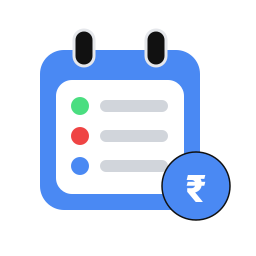

<div align="center">
  
  <h1>SubTrack</h1>
  <p><strong>Centralized Subscription & Expense Intelligence Platform</strong></p>
  <p>Track recurring expenses, visualize financial analytics, prevent surprise renewals, sync with Google Calendar, and stay in total control of your digital services.</p>

  [](https://react.dev/)
  [](https://expressjs.com/)
  [](https://www.mongodb.com/)
  [](https://vitejs.dev/)
  [](LICENSE)
</div>

---

## 📖 Overview

**SubTrack** is a modern, responsive full-stack application engineered to solve "subscription fatigue" and eliminate surprise recurring charges.

SubTrack consolidates all recurring commitments into a single interface with real-time financial pacing, urgent renewal notices, automated Google Calendar synchronization with mobile push alerts, signup email confirmations, and strictly isolated per-user subscription management.

---

## ✨ Key Features & Capabilities

### 1. 🔑 Google Authentication & Email Sign-In
- **Google Sign-In**: Authenticate using official Google Identity Services (`@react-oauth/google`) or connect your Google profile directly.
- **Robust Fallbacks**: Seamless fallback ensures you can sign in and link your Google profile even when Google Cloud Client ID is in development mode.
- **Zero Demo Pollution**: Real user authentication with dedicated accounts and credentials.

### 2. 📧 Automated Signup Confirmation Emails
- **Email Service (`nodemailer`)**: Automatically dispatches a branded welcome & confirmation email upon user registration or new Google signup.
- **Rich HTML Notifications**: Contains account details, security reminders, and quick-start guides to setting up Google Calendar renewals.
- **Flexible SMTP Configuration**: Ready for Gmail, Outlook, or custom SMTP servers (with automatic test inbox fallback in development).

### 3. 📅 Google Calendar Synchronization & Real-Time Management
- **Automatic 2-Way Sync (Direct Google Calendar API v3)**: Connected Google Calendars update in real time. Creating, editing, renewing, or cancelling a subscription automatically creates, updates (PATCH), or removes its Google Calendar event with zero manual action required.
- **Durable Event Mapping & Deduplication**: Each subscription maintains a persistent `googleCalendarEventId` mapping and private extended properties (`subtrackSubscriptionId`, `subtrackUserId`). Repeated sync calls update mapped events instead of creating duplicates.
- **Automatic Duplicate Reconciliation**: The reconciliation engine identifies and deletes redundant duplicates in Google Calendar while preserving unrelated personal calendar events.
- **3-Day and 1-Day Popup Reminders**: Configured with explicit pop-up alarm offsets (4320 mins and 1440 mins before renewal).
- **Four Clear Calendar Modes**:
  1. *Direct Google Calendar API*: Instant 2-way automatic CRUD synchronization.
  2. *1-Click Web Sync Link*: Browser template generator for individual subscription events.
  3. *Live iCalendar Feed URL (`/api/calendar/:userId/feed.ics`)*: Standard webcal feed polled periodically (every 6–24 hours) by calendar applications.
  4. *Download .ICS File*: Offline static calendar snapshot for manual import.

### 4. 🛡️ Strict Per-User Data Isolation
- **User Scoping**: Every subscription is strictly bound to the authenticated `userId`.
- **Database & Cache Separation**: The backend API filters, updates, and deletes records solely for the requesting user (`/api/subscriptions?userId=...`).
- **Private Browser Caching**: Local storage keys are namespaced per user (`subtrack_subscriptions_<userId>`), ensuring no data leakage between different user accounts.

### 5. 💳 Taskbar-Centric Subscription Management
- **Universal Taskbar CTA**: The **"+ Add Subscription"** action is stationed prominently in the primary desktop taskbar and mobile navigation bar.
- **Brand Vector Engine**: High-resolution vector icons for 22+ top platforms (Netflix, Spotify, ChatGPT, Claude, Hotstar, JioCinema, Prime, etc.) with automatic Google Favicon fallback.

### 6. 💰 Currency Intelligence (INR ₹ Default & USD $ Option)
- **Primary Currency**: Default set to Indian Rupees (`₹` INR) with support for US Dollars (`$` USD).
- **Dynamic Conversion**: Live recalculations across charts, calendars, tables, and dashboard stat cards.

### 7. 📊 Spending Analytics & Printable Financial Reports
- **Outflow Doughnut Chart**: Interactive sector cost and percentage distributions.
- **30-Day Cash Flow Forecast**: Chronological timeline highlighting bills due within $\le 7$ days.
- **Printable Financial Report**: Formatted tables and executive summaries with `@media print` styling for clean paper and PDF output.

### 8. ⏳ Interactive Gantt-Style Subscription Renewal Timeline
- **Multi-Range Gantt Chart**: Horizontal calendar views across **Next 7 Days**, **Next 30 Days**, and **Next 90 Days** with backward/forward navigation and a quick "Reset to Today" button.
- **Billing Period Representation**: Visual bars spanning subscription billing cycles that clearly distinguish verified billing periods (solid) from cycle-estimated periods (dashed/striped).
- **Overlapping Renewal Detection**: Automatic detection and highlighting of dates with multiple renewals, complete with combined financial impact grouped by currency (INR & USD).
- **Milestone Pins & Micro-Status**: Animated markers indicating upcoming renewals, urgency badges for renewals due soon ($\le 3$ days), overdue flags, and trial expiration warnings.
- **Rich Hover Tooltips & Fast Editing**: Interactive glassmorphic tooltips displaying service details, amounts, frequencies, and direct click-to-edit integration with existing subscription modals.
- **Dual Dashboard & Dedicated Page Access**: Seamlessly accessible directly on the primary Dashboard and as a dedicated full-page view via the top and mobile navigation bars.

---

## 🏗️ Project Architecture

```
SubTrack/
├── backend/                  # Express 5 REST API & MongoDB
│   ├── config/               # Database connection (db.js)
│   ├── models/               # User.js, Subscription.js
│   ├── routes/               # authRoutes.js, subscriptionRoutes.js, calendarRoutes.js
│   ├── services/             # emailService.js (Nodemailer confirmation emails)
│   ├── .env.example          # Backend environment variables template
│   ├── index.js              # Express server entry point (Port 5000)
│   └── package.json
├── frontend/                 # React 18 + Vite frontend application
│   ├── public/               # Static assets & SVG brand logos
│   ├── src/
│   │   ├── components/       # Calendar, layout, common UI, subscriptions
│   │   ├── context/          # AuthContext.jsx, SubscriptionContext.jsx
│   │   ├── services/         # api.js (Express & MongoDB integration)
│   │   ├── pages/            # Dashboard, Subscriptions, Calendar, Analytics, Profile, Auth
│   │   └── App.jsx
│   ├── .env.example          # Frontend environment variables template
│   ├── vite.config.js        # API proxy configured to forward `/api` to port 5000
│   └── package.json
├── package.json              # Root orchestration scripts
└── README.md
```

---

## 🚀 Getting Started

### Prerequisites
- [Node.js](https://nodejs.org/) (v18.0.0 or higher recommended)
- [npm](https://www.npmjs.com/) (v9.0.0 or higher)
- [MongoDB](https://www.mongodb.com/) (Local MongoDB or MongoDB Atlas URI)

### Quick Start (Frontend & Backend Concurrently)

1. **Install all dependencies**:
   ```bash
   npm run install:all
   ```

2. **Configure Environment Variables**:
   - Backend `backend/.env`:
     ```env
     PORT=5000
     MONGODB_URI=mongodb+srv://<username>:<password>@cluster0.mongodb.net/subtrack
     NODE_ENV=development
     GOOGLE_CLIENT_ID=your-google-client-id.apps.googleusercontent.com

     # Optional SMTP settings for confirmation emails
     SMTP_HOST=smtp.gmail.com
     SMTP_PORT=587
     SMTP_USER=your-email@gmail.com
     SMTP_PASS=your-gmail-app-password
     ```
   - Frontend `frontend/.env`:
     ```env
     VITE_GOOGLE_CLIENT_ID=your-google-client-id.apps.googleusercontent.com
     ```

3. **Launch development servers**:
   ```bash
   npm run dev
   ```
   - **Frontend App**: [http://localhost:5173/](http://localhost:5173/)
   - **Backend API**: [http://localhost:5000/](http://localhost:5000/)
   - **Health Check**: [http://localhost:5000/api/health](http://localhost:5000/api/health)

---

## 📦 Production Build

To compile the production bundle:

```bash
npm run build
```

---

## 🔒 Security & Data Isolation

- **Per-User Scoping**: Every database document and local storage entry is linked to an authenticated user ID.
- **Password Strength Gate**: Client-side enforcement of 4 security criteria (8+ characters, number, symbol, uppercase).
- **Environment Isolation**: Database connection strings, SMTP credentials, and OAuth secrets are kept in ignored `.env` configurations.

---

## 📄 License

This project is open source and available under the [MIT License](LICENSE).
